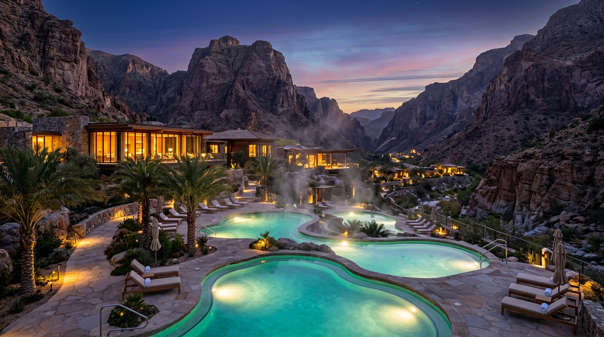
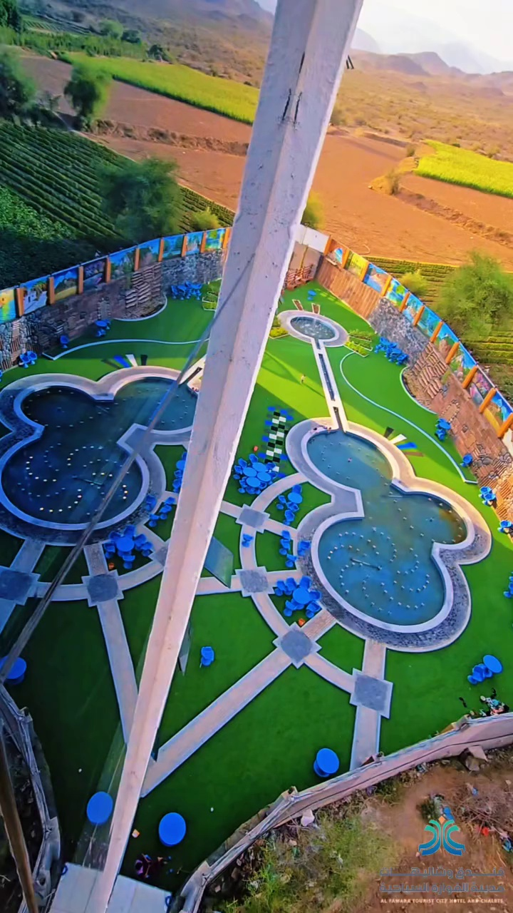
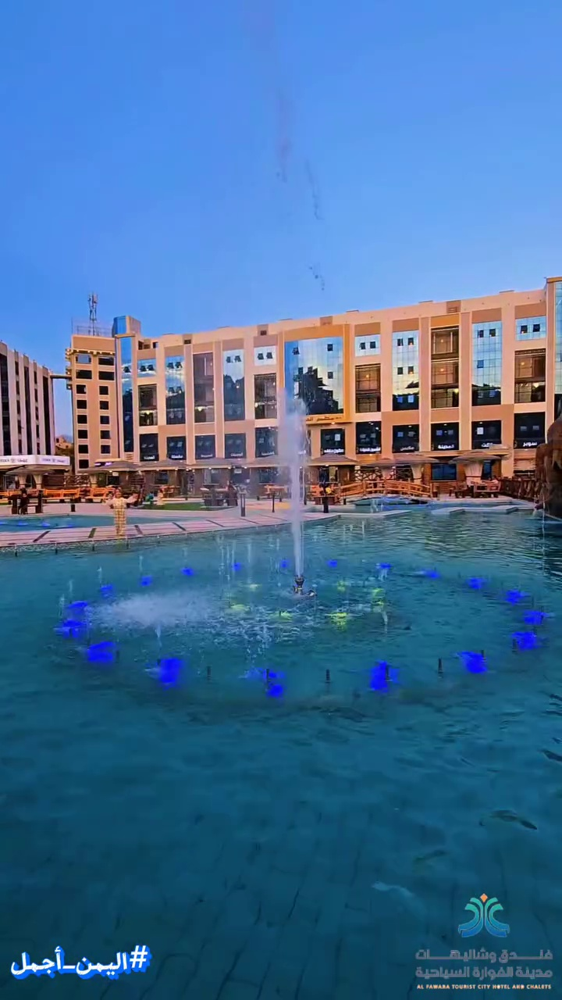
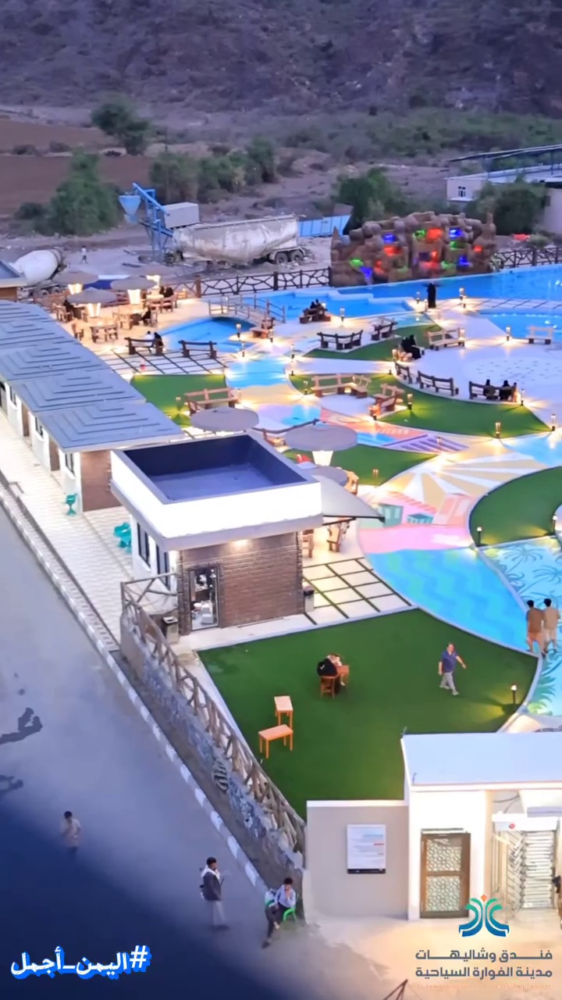
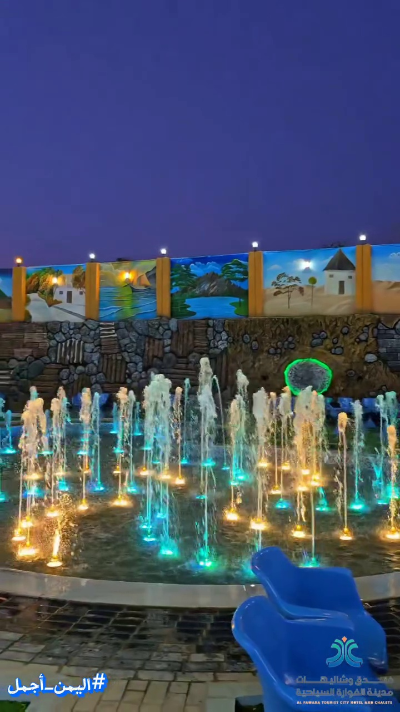
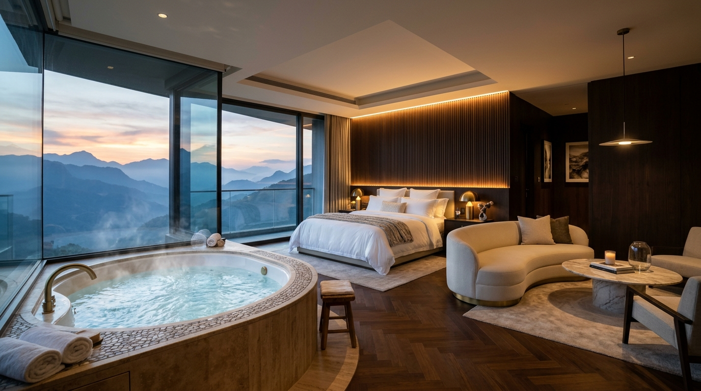

# 🏨 فندق وشاليهات مدينة الفوارة السياحية
### Alfawara Resort & Thermal Springs Hotel | حمام جارف - صنعاء - بلاد الروس

منصة إلكترونية سياحية فاخرة من الجيل الجديد مبنية بأحدث معايير الويب التفاعلي (Next.js 14, Tailwind CSS, TypeScript, WebGL & Video HUD)، مصممة لتقديم تجربة استكشاف حقيقية متكاملة لمنتجع الفوارة الطبيعي، تجمع بين الفخامة الملكية، النماذج ثلاثية الأبعاد، جولات الفيديو الحية، ونظام حجز سريع عبر واتساب ونقاط البيع (POS).

---

## 📸 معرض اللقطات والمشاهد التفاعلية للمنتجع

### 1. الواجهة الترحيبية الكبرى (The Grand Cinematic Hero)

> واجهة كاملة الشاشة تستعرض واحة المنتجع والمسابح الكبريتية وقت الغسق مع نظام حجز فوري عائم.

---

### 2. جولة الفيديو الحية في أرجاء المنتجع (Live Real Resort Tour)
تستعرض مشاهد حقيقية من أرض الواقع عبر 5 محطات تفاعلية:

| 01. الواحة الجوية والمسابح الكبريتية | 03. بحيرة النوافير وواجهات الفندق |
| :---: | :---: |
|  |  |
| *مسابح كبريتية بتصميم هندسي فريد وسط مروج خضراء* | *حوض كبريتي رئيسي ونافورة شاهقة أمام غرف النزلاء* |

| 04. الشاليهات المستقلة والقرية السياحية | 05. النوافير الراقصة ليلاً |
| :---: | :---: |
|  |  |
| *إطلالة علوية على صف الشاليهات الخاصة والشلال الصخري* | *عروض مائية ليلية مضيئة تضفي سحراً ورومانسية* |

---

### 3. جولة الجناح الملكي والجاكوزي 360° (Interactive 360° Royal Suite)

> تجول تفاعلي 360 درجة داخل الجناح الرئاسي الفاخر، مع جاكوزي كبريتي مدمج، إضاءة استرخاء دافئة، بطاقة حجز زجاجية شفافة، ودبابيس معالم تفاعلية.

---

## 🌟 أبرز مميزات المنصة البرمجية

### 1. هيكلية التمرير المقفل الفاخر (Full-Bleed Snap-Scroll Architecture)
- كل قسم من أقسام الموقع يملأ الشاشة بدقة `100dvh` بدون أي تشويش أو فراغات.
- تمريرة واحدة تنقل الزائر بسلاسة فائقة بين المحطات عبر مكتبة `smoothScrollTo` مع متابعة مستمرة لمؤشر التمرير الجانبي عبر `IntersectionObserver`.

### 2. جولة الفيديو الحقيقية مع بطاقات تفاعلية شفافة (Video Walkthrough HUD)
- يعمل الفيديو الأصلي للمنتجع في الخلفية مع **بطاقة زجاجية شفافة وذكية (Crystal Glass HUD)** تتبدل بسلاسة مع كل محطة دون إشغال الشاشة.
- شريط تقدم خفيف مستوحى من قصص إنستغرام (5 مقاطع متتالية) مع إمكانية القفز الفوري لأي معلم.
- دبابيس استكشاف نابضة تتيح للزائر معرفة مواصفات المرفق والحجز الفوري عبر واتساب.

### 3. محرك الحجز والتأكيد الفوري عبر واتساب المجاني (Zero-Friction WhatsApp Engine)
- حجز بنقرة واحدة يقوم بصياغة تذكرة كاملة تتضمن اسم الجناح، تاريخ الوصول، عدد الأفراد، ونظام الإقامة (يومي / بالساعة).
- ربط مباشر بأرقام خدمة العملاء والاستقبال المعتمدة في المنتجع.

### 4. نظام الكاشير والاستقبال الداخلي (POS & Reception Dashboard)
- لوحة كاشير مخصصة لموظفي الاستقبال لإدارة الغرف وتسكين النزلاء.
- دعم طباعة فواتير وسندات حرارية بمقاس 80mm متوافقة مع جميع طابعات الـ POS الحرارية.
- تشغيل محلي غير معتمد على الإنترنت (Offline Resilience) لضمان استمرار الحجوزات حتى في حال انقطاع الشبكة في المناطق الجبلية.

### 5. الدليل الصحي الموثق للمياه الكبريتية (Balneotherapy Health Guide)
- استعراض علمي للخصائص العلاجية لمياه حمام جارف الطبيعية (المفاصل، الروماتيزم، نضارة البشرة، خفض التوتر).
- توضيح بروتوكول الاستخدام الآمن للنزلاء والعائلات بلغة سلسة وجذابة.

---

## 🏛️ الوحدات والمرافق الموثقة في المنصة

1. **جناح عائلي VIP (5+ أفراد):** جاكوزي كبريتي داخلي، صالة جلوس، إطلالة جبلية.
2. **غرفة عائلية VIP مع جاكوزي:** خصوصية كاملة وخدمة غرف راقية.
3. **شاليه مسبح خاص (نظام ساعات / يومي):** مسبح كبريتي خاص مغلق للعائلات.
4. **المجلس الكبير للمناسبات (50 شخص):** حوض كبريتي وجلسة دائرية فاخرة.
5. **مجلس شبابي متوسط (30 شخص):** مع 2 جاكوزي كبريتي دافئ.
6. **مجلس شبابي خاص (20 شخص):** مع 2 جاكوزي كبريتي دافئ.
7. **مجلس صغير هادئ (10 أشخاص):** مع جاكوزي خاص.
8. **غرفة نوم شبابية:** مع جاكوزي خاص.
9. **مسابح عائلية كبريتية خاصة:** حجز بالساعة بخصوصية تامة 100%.

---

## 💳 الحسابات البنكية والمحافظ المعتمدة في النظام

- **بنك الكريمي (ريال يمني):** `3162933514`
- **بنك الكريمي (ريال سعودي):** `3163017015`
- **بنك الكريمي (دولار أمريكي):** `3162981055`
- **محفظة جيب (Jeeb):** `5907771`
- **التحويل المباشر:** باسم المسؤول المباشر عبر أي شبكة صرافة `784555515`

---

## 🛠️ البنية التقنية (Tech Stack)

- **Framework:** Next.js 14 (App Router, Static Generation)
- **Language:** TypeScript 5
- **Styling:** Tailwind CSS 3.4
- **Icons:** Lucide React
- **Video & 3D Engine:** HTML5 Canvas, WebGL, CSS Scroll-Snap
- **SEO & Structured Data:** Schema.org JSON-LD (Resort & Hotel Schema)

---

## 🚀 التشغيل والتطوير المحلي

```bash
# 1. تثبيت الحزم البرمجية
npm install

# 2. تشغيل بيئة التطوير
npm run dev

# 3. بناء النسخة الإنتاجية
npm run build

# 4. تشغيل خادم الإنتاج
npm run start -p 8080
```

---

## 📄 حقوق التطوير والإنتاج

تم تصميم وتطوير المنصة بواسطة **فن الإعلان (Fanalelan)**  
جميع الحقوق محفوظة لصالح **فندق وشاليهات مدينة الفوارة السياحية - حمام جارف**.
